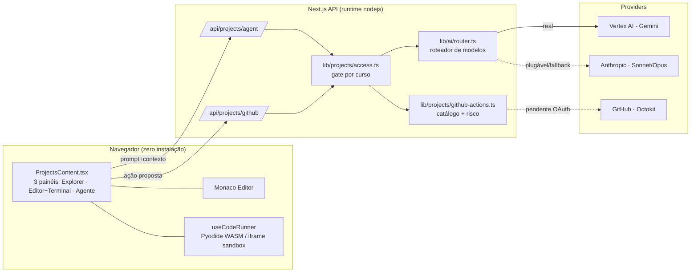

# Projetos — IDE Agêntica Embarcada (Especificação Técnica)

> Submódulo **Projetos** do Zaeon OS, dentro da Sala de Pesquisa (`/research-lab`),
> logo abaixo da Sala de Estudos na sidebar. IDE de código agêntica que roda no
> navegador, com integração GitHub, conduzida por LLMs (Gemini hoje; Sonnet/Opus
> como tier plugável).

**Status honesto desta entrega (não superestimar):**

| Camada | Estado real neste repo |
|---|---|
| UI / sala / sidebar | ✅ Implementada e integrada (`ProjectsContent.tsx`) |
| Execução de código no navegador | ✅ Real (Pyodide + iframe sandbox, via `useCodeRunner`) |
| Agente / geração (Gemini Vertex) | ✅ Real (`/api/projects/agent` → `lib/ai/router.ts`) |
| Gate de acesso por curso | ✅ Real (`lib/projects/access.ts`, 2 camadas) |
| Roteamento Sonnet/Opus (Anthropic) | ⚠️ Contrato + fallback (sem SDK/chave neste ambiente) |
| Integração GitHub (commits/PRs reais) | ⚠️ Catálogo + gates de aprovação; sem Octokit/OAuth app |
| Workspace = repositório clonado | ⚠️ Mock em memória (3 arquivos starter) |

Suposições explícitas estão marcadas com **[SUPOSIÇÃO]**. Onde a capacidade do
modelo é incerta, está marcado **[INCERTO]**.

---

## 1. Arquitetura geral



**Componentes nomeados:**

- **Frontend** — `app/research-lab/projects/ProjectsContent.tsx` (client component,
  carregado via `dynamic(..., { ssr:false })` em `app/research-lab/page.tsx`).
  Reaproveita `@/app/agentic-modules/codelab/useCodeRunner` para execução real no
  navegador e `@monaco-editor/react` para edição.
- **Orquestração agêntica** — `app/api/projects/agent/route.ts`. Recebe
  `{ level, task, prompt, context, forceModel }`, aplica gate, roteia o modelo e
  devolve um payload tipado (`kind: message|diagram|doc|edit|plan`).
- **Integração GitHub** — `app/api/projects/github/route.ts` + catálogo
  `lib/projects/github-actions.ts`. `GET` devolve o catálogo e escopos; `POST`
  valida ação contra aprovação/autonomia (execução real pendente de Octokit).
- **Roteador de modelos** — `lib/ai/router.ts`. Função pura `route()` + executor
  `generate()`. Gemini via `GEMINI_MODEL` (`lib/ai/model.ts`).

**Contratos de dados** (resumo):

```ts
// POST /api/projects/agent
type AgentRequest = {
  level: "prototype" | "implementation" | "autonomy";
  task: "chat"|"diagram"|"doc"|"edit"|"scaffold"|"architecture"|"debug"|"refactor"|"plan";
  prompt: string;
  context?: string;        // arquivo ativo + trechos (≤12k chars server-side)
  forceModel?: "sonnet"|"opus"|"gemini";
  allowAnthropic?: boolean;
};
type AgentResponse = {
  routing: { model: string; provider: "google"|"anthropic"; reason: string; fallbackFrom?: string };
  kind: "message"|"diagram"|"doc"|"edit"|"plan";
  content: string;         // markdown / mermaid / file body
  plan?: { title: string; action: string; githubAction: string|null; needsApproval: boolean }[];
};
```

---

## 2. Gate de acesso por curso/área

**Regra dura:** a IDE só habilita para Computação e correlatas. Fonte da verdade:
`lib/projects/access.ts`, ancorado em `User.course` (Prisma) — o mesmo conjunto da
trilha "cyber" usada em `app/workstation/*`.

- **Mecanismo:** *claim no perfil* (`User.course`, definido no onboarding a partir
  de um dropdown fixo). Normalização (remove acento, lowercase) + match exato contra
  `ELIGIBLE_COURSES` e fallback por palavra-chave (`ADS`, `Computer Science`,
  `Eng. de Software`, etc.).
- **Fail-closed:** curso vazio/desconhecido → **não elegível** (decisão deliberada de
  menor privilégio, porque a feature escreve no GitHub).
- **Duas camadas de enforcement** (espelha `agentic-modules/biosim3d/accessPolicy.ts`):
  1. **API** — toda rota chama `assertEligibleOrThrow(course)` antes de qualquer
     trabalho; não elegível → `403 { reason }`.
  2. **UI** — `ProjectsContent` sonda `GET /api/projects/github`; `403` → painel de
     fallback (`NOT_ELIGIBLE_COPY`) com CTA para o Perfil.

**[SUPOSIÇÃO]** Verificação institucional / flag de matrícula real (SIS da
instituição) não existe hoje; o claim de perfil é o gate atual. Quando houver
integração institucional, basta trocar a fonte em `checkEligibility()` (curso →
matrícula verificada) sem mudar os call-sites.

**Cursos elegíveis (canônicos):** Ciência da Computação, Engenharia de Software,
Sistemas de Informação, Análise e Desenvolvimento de Sistemas, Engenharia da
Computação, Redes de Computadores, Segurança da Informação / Cibersegurança, Banco de
Dados, Inteligência Artificial, Ciência de Dados, Computação em Nuvem, Internet das
Coisas, Jogos Digitais, Computer Science, Software Engineering.

---

## 3. Os três níveis de atuação

### Nível 1 — Prototipação
- **Entregáveis:** diagramas (flowchart, ER, sequência, classe, C4 quando aplicável)
  em **Mermaid**; resumo documental (Escopo, Requisitos, Decisões técnicas, Riscos,
  Roadmap).
- **Fluxo:** UI envia `task: "diagram" | "doc"` → `route()` escolhe **Gemini**
  (estruturado, barato, contexto longo) → UI renderiza o Mermaid no painel do agente.
- **GitHub:** nenhuma escrita; opcionalmente `create_issue` para registrar decisões.

### Nível 2 — Implementação
- **Entregáveis:** edição cirúrgica por arquivo, scaffolding, testes, documentação
  técnica. Edição "estilo Claude Code": lê o contexto do arquivo ativo, propõe o
  conteúdo completo atualizado, o usuário aplica no Monaco; execução iterativa real
  via `useCodeRunner` (Python/JS/HTML no navegador).
- **Fluxo:** `task: "edit" | "scaffold"` → **Sonnet** (alto volume/iteração) com
  fallback Gemini → diff/aplicação no editor → "Rodar" executa no navegador →
  verificação pela saída do terminal.
- **GitHub:** `create_branch`, `commit` (somente branch de trabalho), `comment_pr`.

### Nível 3 — Autonomia agêntica
- **Entregáveis:** loop **planejar → editar → rodar → verificar → corrigir** com
  *checkpoints* de aprovação; operações multi-arquivo, refator amplo, CI.
- **Fluxo:** `task: "plan"` → **Opus** (raciocínio) → backend devolve `plan[]` com
  `needsApproval` **re-carimbado no servidor** a partir do catálogo (nunca confia no
  modelo). UI mostra cada passo; ações irreversíveis exigem clique humano.
- **Limite duro:** o loop **não** executa ações `autonomyAllowed:false`
  (merge, push em main, delete, abrir PR) — sempre pausa para aprovação.

---

## 4. Catálogo de ações GitHub (aprovação)

Fonte: `lib/projects/github-actions.ts`. `🔒` = irreversível, `✋` = revisão,
`✓` = seguro.

| Ação | Escopo mínimo | Risco | Aprovação humana | Autônoma? |
|---|---|---|---|---|
| `list_repos` / `read_tree` / `read_file` / `read_diff` / `list_issues` | `repo:read` | ✓ | não | sim |
| `create_branch` | `repo:write` | ✋ | não | sim |
| `commit` (branch de trabalho) | `contents:write` | ✋ | não | sim |
| `comment_pr` | `pull_request:write` | ✋ | não | sim |
| `create_issue` | `issues:write` | ✋ | não | sim |
| `open_pr` | `pull_request:write` | ✋ | **sim** | não |
| `edit_issue` (editar/fechar) | `issues:write` | ✋ | **sim** | não |
| `merge_pr` | `pull_request:write` | 🔒 | **sim** | não |
| `push_default` (push em main) | `contents:write` | 🔒 | **sim** | não |
| `delete_branch` | `repo:write` | 🔒 | **sim** | não |
| `force_push` | `contents:write` | 🔒 | **sim** | não |

**Menor privilégio:** escopos OAuth concedidos por feature, não amplos; ação
desconhecida → `requiresApproval` retorna `true` (fail-closed). **[SUPOSIÇÃO]** OAuth
app GitHub + token de instalação ainda não configurados; quando existirem, a execução
entra em `executeAction()` (única mudança localizada na rota).

---

## 5. Política de roteamento Sonnet / Opus / Gemini

Função pura e testável `route(req)` em `lib/ai/router.ts`. Ordem de precedência:

1. **Override do usuário** (`forceModel`) — seletor "Auto/Sonnet/Opus/Gemini" na UI.
2. **Contexto grande** (`> 80k tokens`) → **Gemini** (janela longa).
3. **Política por tarefa/nível:**
   - `architecture` · `debug` · `plan` → **Opus** (raciocínio profundo).
   - `refactor` em nível `autonomy` → **Opus**.
   - `diagram` · `doc` → **Gemini** (estruturado, barato).
   - demais (`edit`, `scaffold`, `chat`) → **Sonnet** (alto volume/iteração).
4. **Gate de disponibilidade Anthropic** (fail-soft): se o modelo escolhido é
   Anthropic mas `ANTHROPIC_ENABLED` é falso, faz **fallback automático para Gemini**
   e reporta via `decision.fallbackFrom` (a UI mostra "fallback de opus").

**Critérios objetivos:** custo/latência favorecem Sonnet/Gemini em volume; qualidade
de raciocínio favorece Opus em arquitetura/debug. **[INCERTO]** Comparação empírica
custo/latência/qualidade entre Gemini 2.5 e Sonnet/Opus para *este* domínio ainda não
foi medida; os limiares (ex.: 80k tokens) são pontos de partida a calibrar com
telemetria de produção.

**Ativar Anthropic:** `npm i @anthropic-ai/sdk`; setar `ANTHROPIC_API_KEY` +
`PROJECTS_ANTHROPIC=on` (+ opcional `ANTHROPIC_SONNET_MODEL`/`ANTHROPIC_OPUS_MODEL`);
implementar `callAnthropic()`. Sem isso, o caminho "anthropic" nunca é alcançado.

---

## 6. Modelo de segurança e sandboxing

- **Execução de código no navegador:**
  - **Python** → Pyodide (CPython em WebAssembly), isolado do host; sem acesso a FS
    local nem rede do usuário.
  - **JS/TS/HTML** → `iframe` sandbox com `postMessage` (sem `allow-same-origin`
    para código não confiável). **[SUPOSIÇÃO]** Recomenda-se `sandbox="allow-scripts"`
    e CSP estrita no iframe de preview; revisar a flag atual de `useCodeRunner`.
- **Segredos:** chaves Vertex/Anthropic ficam **só no servidor** (rotas `runtime:
  nodejs`); o navegador nunca recebe credencial de provedor.
- **GitHub:** menor privilégio (escopos por ação), confirmação humana obrigatória para
  irreversíveis, branch de trabalho por padrão (nunca commit direto em main pelo loop).
- **Gate antes de tudo:** nenhuma rota faz trabalho de IA/GitHub antes de
  `assertEligibleOrThrow`.
- **Não confiar no modelo:** flags de aprovação dos passos são **re-carimbadas no
  servidor** a partir do catálogo, ignorando o que o LLM declarou.
- **Limites a definir [SUPOSIÇÃO]:** timeout de execução (ex.: 10s/run), teto de
  memória do Pyodide, rate-limit por usuário nas rotas, quota de tokens por sessão,
  e auditoria (log de cada ação GitHub proposta/aprovada).

---

## 7. Riscos, trade-offs e o que NÃO deve ser autônomo

**Nunca autônomo (sempre aprovação humana):** `merge_pr`, `push_default`,
`delete_branch`, `force_push`, `open_pr`, `edit_issue`. Razão: irreversibilidade ou
impacto amplo.

**Riscos & mitigações:**

- *Código malicioso/loop infinito na execução* → sandbox WASM/iframe + timeout +
  teto de memória.
- *Alucinação em refator amplo* → checkpoints obrigatórios, diffs revisáveis,
  commits só em branch de trabalho, reversibilidade via PR/revert.
- *Vazamento de segredo do repositório* → escopos mínimos, sem `repo` amplo,
  redigir segredos do contexto enviado ao modelo **[SUPOSIÇÃO: filtro de segredos a
  implementar]**.
- *Fallback silencioso de modelo* → exposto na UI (`fallbackFrom`) e no `routing`.
- *Custo de tokens* → roteamento para tiers baratos por padrão + quota por sessão.

**Trade-offs assumidos:** priorizamos **segurança e reversibilidade sobre autonomia
total** — o nível 3 é "autônomo com coleira", não "auto-merge". Workspace em memória
(mock) hoje troca fidelidade de repositório por simplicidade; o salto para repositório
clonado real depende do OAuth app GitHub + storage de workspace.

---

## Mapa de arquivos desta entrega

```
app/research-lab/projects/ProjectsContent.tsx   # UI da IDE (client)
app/research-lab/page.tsx                        # sidebar + aba "projetos" (editado)
app/api/projects/agent/route.ts                  # orquestração agêntica
app/api/projects/github/route.ts                 # catálogo + gates GitHub
lib/ai/router.ts                                 # roteador de modelos
lib/projects/access.ts                           # gate por curso
lib/projects/github-actions.ts                   # catálogo de ações + risco
docs/PROJECTS_AGENTIC_IDE_SPEC.md                # este documento
```
